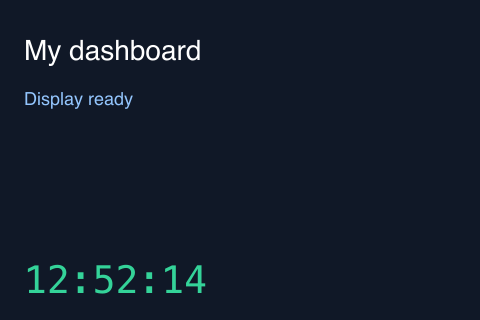

# turzx-render — Node.js library for TURZX USB displays

[](https://github.com/Pamsho09/turzx-render/actions/workflows/ci.yml)
[](LICENSE)

Control a **TURZX / Turing Smart Screen / UsbMonitor 3.5-inch USB display** from
Node.js or TypeScript. Render images, text, SVG dashboards and partial RGB565
updates using direct USB bulk transfers. Includes a command-line tool and
TypeScript declarations. Tested with the original panel on macOS.



The preview is generated by the included example, not a photograph of the hardware.

## Features

- Display PNG, JPEG and other image formats supported by `sharp`.
- Render SVG text, charts and dashboard cards from a buffer.
- Update individual regions without repainting the whole screen.
- Set brightness, rotate the panel, clear it, or turn its output on and off.
- Serialize USB writes so commands do not interrupt bitmap payloads.
- Use the same API from JavaScript, TypeScript or the included CLI.

Your application supplies the content. The library has no account connections,
usage trackers or background services.

## Installation

Install the current release directly from GitHub:

```bash
npm install github:Pamsho09/turzx-render#v1.0.2
```

The package is **not published to the npm registry yet**. The command above works
through npm's GitHub support. Once it is published, the registry command will be
`npm install turzx-render`. See [Publishing to npm](PUBLISHING.md) for the release checklist.

GitHub installation compiles TypeScript through `prepare`. To build a tarball:

```bash
git clone https://github.com/Pamsho09/turzx-render.git
cd turzx-render
npm ci
npm pack
# From another project:
npm install /path/to/turzx-render/turzx-render-1.0.2.tgz
```

Requires **Node.js 20+**; Node 24 is recommended. `usb` and `sharp` have native
components: reinstall dependencies when changing CPU architecture or Node runtime.
This is a Node.js library, not a browser or WebUSB library.

## Supported hardware

| Property | Supported / tested configuration |
| --- | --- |
| Panel | TURZX / Turing / UsbMonitor 3.5-inch, Revision A protocol |
| USB identity | VID `1a86`, PID `5722`; tested serial `USB35INCHIPSV2` |
| Resolution | Portrait: 320 × 480; landscape: 480 × 320 |
| Transport | USB bulk, interface 1, OUT endpoint `0x03`, through libusb |
| Operating system | Tested on macOS; Linux and Windows are not hardware-validated here |

Other panels sold under the same brand may use a different protocol. Do not assume
compatibility with every 3.5-inch model or with 5-inch and 7-inch screens.

Only one process can own the display. Close any monitoring app or manufacturer
software using it before running your own project.

## Quick start: display an image

Use a `.mjs` file, or set `"type": "module"` in your project's `package.json`:

```js
import { TurzxDisplay, Orientation } from 'turzx-render';

const display = await TurzxDisplay.open({
  orientation: Orientation.Landscape,
  brightness: 70,
});

try {
  await display.drawImage('./photo.png', { fit: 'contain' });
} finally {
  await display.close();
}
```

`close()` releases USB and reattaches the kernel driver if it was detached. The
last image remains on the panel. Use `clear()` to erase it or `screenOff()` to
turn off its output before closing.

## Render text and SVG dashboards

The panel receives pixels. Generate an SVG for text, icons or charts, then pass
its encoded bytes to `drawImage`. The library converts it through `sharp`:

```js
const svg = Buffer.from(`<svg xmlns="http://www.w3.org/2000/svg" width="480" height="320">
  <rect width="480" height="320" fill="#101827"/>
  <text x="24" y="70" font-family="sans-serif" font-size="32" fill="white">Hello, display</text>
</svg>`);
await display.drawImage(svg);
```

Escape XML special characters when inserting external text. Available fonts depend
on the machine rendering the image.

## Partial updates: redraw only what changes

For a clock or percentage, update its rectangle instead of sending a full frame:

```js
import { loadFramebuffer } from 'turzx-render';

const row = Buffer.from(`<svg xmlns="http://www.w3.org/2000/svg" width="480" height="80">
  <rect width="480" height="80" fill="black"/>
  <text x="20" y="50" fill="white" font-size="32">42%</text>
</svg>`);
const pixels = await loadFramebuffer(row, 480, 80);
await display.drawRegion(0, 240, 480, 80, pixels);
```

Coordinates follow the current orientation, starting at the top-left corner.
`drawRegion` requires exactly `width × height × 2` bytes of RGB565 little-endian
pixels. Convert encoded PNG/JPEG/SVG input with `loadFramebuffer` first.

## Runnable examples

After cloning the repository and running `npm ci`:

```bash
node examples/image.mjs ./assets/test.png
npm run example:dashboard
# Generate an image without accessing USB:
npm run example:dashboard -- --preview /tmp/turzx-dashboard.png
```

The dashboard paints a base frame and updates the clock row. Press Ctrl+C to
release the device. Examples import the public package API, just like a consumer.

## API reference

| API | Behavior |
| --- | --- |
| `TurzxDisplay.open({ orientation?, brightness?, timeoutMs? })` | Open USB; landscape by default; default transfer timeout: 10 seconds |
| `findDisplay()` | Return USB identity, or `undefined`, without claiming the panel |
| `display.device` | Identity of the open panel |
| `display.width`, `display.height`, `display.orientation` | Current geometry |
| `setOrientation(orientation)` | `Portrait`, `Landscape`, `ReversePortrait` or `ReverseLandscape` |
| `setBrightness(percent)` | Brightness from 0 to 100; adapts the firmware's inverted scale |
| `drawImage(pathOrBuffer, { fit?, background?, atomic? })` | Full-screen image; `cover` by default; `contain` adds padding |
| `drawRegion(x, y, width, height, pixels, { atomic? })` | RGB565 LE rectangle, with bounds and payload-size checks |
| `fill(r, g, b)` | Solid color; components from 0 to 255 |
| `clear()` | Clear the panel and restore its orientation |
| `screenOn()`, `screenOff()` | Turn panel output on or off |
| `reset()` | Reboot and close the instance; reopen after USB reconnects |
| `close()` | Wait for pending operations and release USB; safe to call repeatedly |
| `sendRaw(bytes)` | Advanced commands through the same write queue |
| `loadFramebuffer(source, width, height, options?)` | Convert an image to RGB565 LE |
| `rgb888ToRgb565(buffer)` | Convert three-byte RGB pixels to two-byte RGB565 |
| `solidFramebuffer(width, height, r, g, b)` | Create a solid-color framebuffer |

Panel operations are asynchronous; use `await`. Serialization is per instance.
Do not open multiple controllers for the same panel or write to its endpoint
outside the library while a transfer is in progress.

## Command-line tool

After installation in your project:

```bash
npx turzx --list
npx turzx ./photo.png --contain --brightness 70
npx turzx ./photo.png --portrait
npx turzx --clear
npx turzx --help
```

Inside this repository, `npm run dev -- --list` also works.

## Performance and direct USB transport

The development unit sustained approximately **171 KB/s**. A full landscape frame
contains **307,200 bytes** and takes about **1.9 seconds**; a 480 × 80 row takes
about **0.45 seconds**. These are measurements from one panel, not guarantees.
Use partial updates and avoid queuing frames faster than the panel can receive.
This hardware is not intended for 30/60 FPS video playback.

The panel displays bytes as they arrive. `atomic: true` blanks the output during
transfer and turns it back on afterward. It hides the visible sweep but does not
add double buffering or increase throughput. Small-region updates with `atomic`
can flash the entire screen; reserve it mainly for full-screen changes.

Direct USB bulk transfers are used because the serial CDC path misplaced bitmap
pixels in the tested macOS setup. Solid colors could hide the issue. Use the
asymmetric pattern in `assets/test.png` when diagnosing image corruption.

## Troubleshooting

| Symptom | What to check |
| --- | --- |
| `No display found` | Cable, USB port and supported VID/PID |
| `Unable to claim USB interface` | Close other software controlling the panel |
| Short write or timeout | Close the instance, check the connection and open a new one |
| Image is upside down | Select `ReverseLandscape` or `ReversePortrait` |
| Serial port does not reappear | Call `close()` to release the interface |

Errors are propagated to your application; automatic reconnection is not included.
After physical disconnection or `reset()`, open a new instance. Add a delay to any
application-level retry loop.

## Development and testing

```bash
npm ci
npm run typecheck
npm test
npm run build
npm pack --dry-run
```

- `src/usb.ts`: USB transport.
- `src/protocol.ts`: wire commands and coordinates.
- `src/image.ts`: image decoding and RGB565 conversion.
- `src/display.ts`: display controller.
- `src/index.ts`: public exports; `dist/` is generated by the build.

Tests run without a display and cover coordinate packing, orientation, brightness,
RGB565 conversion and framebuffer sizes. Physical output and other OS drivers
require hardware testing. See [Publishing to npm](PUBLISHING.md) for maintainer instructions.

## License and protocol reference

[MIT](LICENSE). Protocol reference:
[turing-smart-screen-python, Revision A](https://github.com/mathoudebine/turing-smart-screen-python/blob/main/library/lcd/lcd_comm_rev_a.py).
This project implements its own Node.js client using `usb` and `sharp`.
